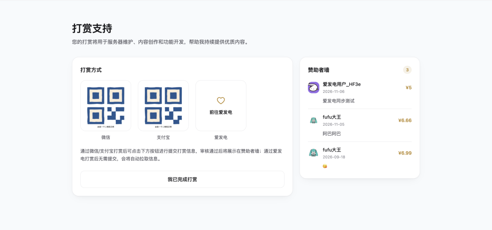
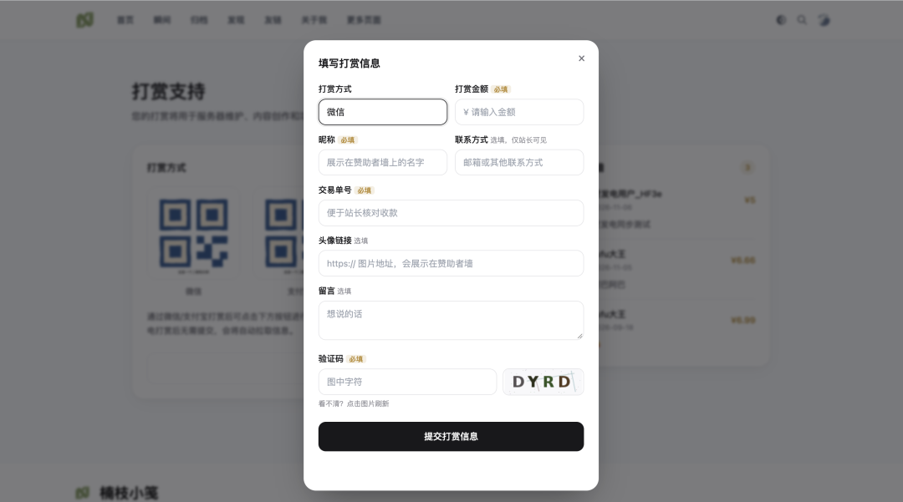
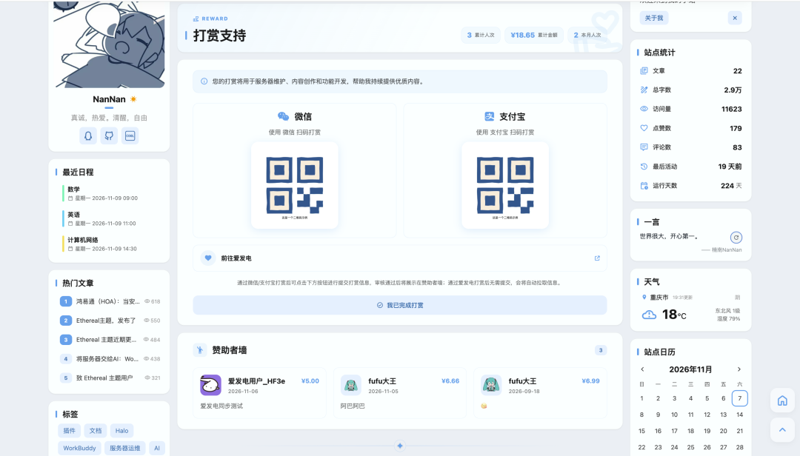

# Halo-Plugin-Reward 打赏插件

为使用 Halo 建站系统的个人站长提供独立打赏页面。站长配置自己的微信 / 支付宝收款码，访客扫码打赏后提交打赏记录，站长在后台确认后展示赞助者墙；同时支持对接爱发电，订单可自动同步入库并展示。

**本插件不参与资金流转**：不接入支付网关，不代收、不结算、不抽成。微信 / 支付宝的款项直接进入站长自己的收款账户；爱发电为可选对接，插件只通过其开放接口读取订单数据，不托管任何资金。

## 前台页面

访问 `/<你的站点>/reward`。

> 页面会套用主题的 `layout` 契约（`html (head, content)`，Halo 2.26.0+）；主题未提供该片段时无法套用主题外壳。
> 若站点已存在占用 `/reward` 路径的单页，请先调整该单页的固定链接。




点击按钮后弹出模态框：



- 收款码点击可放大查看
- 模态框支持 ESC 或点击遮罩关闭，提交成功后自动关闭
- 桌面端两栏，窄屏自动单栏

## 功能特性

**前台**

- 独立页面 `/reward`，支持微信、支付宝与爱发电三种打赏方式
- 打赏信息表单以模态框呈现，点击按钮弹出，不占用页面空间
- 赞助者墙展示昵称、头像、留言与金额，只显示已确认的记录
- 自动套用当前主题的页头与页脚（Halo 2.26.0+）
- 前台资源完全本地，不加载任何外部 CDN、字体或统计脚本

**后台**

- 配置项集中在插件设置，分基础、收款、记录、爱发电、通知五组
- 打赏记录页：搜索、状态筛选、批量确认 / 拒绝 / 删除、CSV 导出
- 点击列表行可编辑记录内容，支持后台手动新增；打赏时间可填写，用于补录历史打赏
- 有新的待确认记录时，页面顶部给出提示卡片
- 角色权限：`打赏记录查看` 仅能浏览列表；`打赏记录管理` 才能新增、编辑、确认、删除、同步与导出

**集成能力**

- Finder API：主题模板可直接获取收款码、赞助者墙与统计
- 公开 REST API：配置、墙面、统计、验证码、提交
- 主题可一行引用提交模态框，也可用自己的表单

**安全与防刷**

- 图形验证码（默认开启），5 分钟过期、一次性使用
- 提交限流：每 IP 10 分钟 5 次
- 验证码获取限流：每 IP 1 分钟 10 张
- 联系方式与交易单号仅后台可见，任何匿名接口都不返回

## 安装使用

### 系统要求

- **Halo** >= 2.27.0
- 前台页面使用 Halo 的页面布局契约（`layout`），低于 2.26.0 无法使用该契约

### 在线安装（推荐）

1. Halo 应用商店搜索「打赏插件」一键安装
2. 启用插件
3. 进入插件设置完成配置（见下文「配置项」）
4. 在站点菜单、关于页或文章中添加入口，指向 `/reward`

### 手动安装

1. 前往 [Releases](https://github.com/AloneNanNan/halo-plugin-reward/releases) 下载最新版本的插件 JAR
2. 进入「**Halo 后台 → 插件 → 安装**」，上传插件 JAR
3. 启用插件
4. 进入插件设置完成配置（见下文「配置项」）
5. 在站点菜单、关于页或文章中添加入口，指向 `/reward`

## 插件升级

1. 后台「插件」页面会提示可用更新，点击升级即可

2. 或前往 [Releases](https://github.com/AloneNanNan/halo-plugin-reward/releases) 手动下载最新版本的插件 JAR，手动上传新版本 zip 覆盖安装

## 配置项

### 基础设置

| 字段 | 说明 |
| --- | --- |
| 启用打赏页面 | 关闭后 `/reward` 返回 404，已产生的记录不受影响 |
| 页面标题 | 前台页面主标题 |
| 页面简介 | 标题下方的说明文字，可留空 |
| 货币符号 | 显示在金额前的符号，默认 `¥` |

### 收款设置

| 字段 | 说明 |
| --- | --- |
| 微信收款码 | 从 Halo 附件库选择图片 |
| 支付宝收款码 | 从 Halo 附件库选择图片 |
| 收款提示 | 显示在收款码下方，建议说明「需手动输入金额」 |

### 记录与展示

| 字段 | 说明 |
| --- | --- |
| 允许访客提交打赏记录 | 关闭后前台只展示收款码，不收集记录 |
| 仅登录用户可提交 | 开启后未登录访客无法提交 |
| 允许填写留言 | 关闭后表单不显示留言框 |
| 提交时校验图形验证码 | 默认开启 |
| 要求填写交易单号 | 开启后前台显示交易单号输入框且必填，便于核对收款 |
| 允许访客填写头像地址 | 开启后前台显示头像输入框（选填，仅接受 http(s)），头像会展示在赞助者墙 |
| 提交后自动通过 | 关闭时新记录为「待确认」，需人工确认后才上墙 |
| 展示赞助者墙 | 是否在前台展示赞助者墙 |
| 赞助者墙每页条数 | 1 ~ 50 |
| 在赞助者墙显示金额 | 关闭后只展示昵称与留言 |

### 爱发电

| 字段 | 说明 |
| --- | --- |
| 启用爱发电 | 开启后可使用订单回调与手动同步 |
| 开发者 user_id | 爱发电开发者后台获取 |
| API 凭据 | 选择包含 `token` 键的 Halo 密钥 |
| 爱发电主页 | 填写后前台展示「前往爱发电」卡片 |
| 订单自动确认并展示 | 关闭时订单入库为待确认 |

### 通知

| 字段 | 说明 |
| --- | --- |
| 有新的打赏记录时通知管理员 | 适用于前台表单提交产生的记录 |
| 爱发电新订单入库时通知管理员 | 仅平台订单回调会通知；后台手动同步不通知，避免导入历史订单时被连续提醒 |

## 爱发电对接

1. 在爱发电开发者后台 `https://afdian.com/dashboard/dev` 获取 `user_id` 与 `api token`
2. 插件设置「爱发电」：打开「启用爱发电」，填入 `user_id`
3. 点击「API 凭据」新建一个密钥：**键名填 `token`，值填爱发电 api token**；也可以直接选择已有密钥
4. 将以下地址填入爱发电开发者后台的 Webhook 通知地址：

```
https://你的域名/apis/api.reward.nanzhiy.cn/v1alpha1/afdian/webhook
```

5. 填写「爱发电主页」后，前台打赏页会显示爱发电入口卡片
6. 历史订单可在「内容 → 打赏」点击「同步爱发电」补录（最多最近 250 条）

说明：

- 爱发电回调**没有签名机制**，插件在入库前会调用 `query-order` 反查，只有单号一致、真实存在且支付成功的订单才会入库，伪造请求会被丢弃
- 反查不到（刚支付就回调、凭据未配置等）不会入库，但会在日志里留一条 `warn`；平台收到成功响应后不会重推，这类订单需要在后台点「同步爱发电」补齐
- 记录以 `afdian-{订单号}` 为唯一标识，重复推送不会重复创建
- 订单昵称与头像通过 `query-sponsor` 反查，带 10 分钟缓存；查不到时昵称显示为「匿名读者」，头像留空
- 若站点前置了 CDN / WAF（如阿里云 ESA），需将 Webhook 路径加入白名单，否则爱发电的服务器请求会被人机校验拦截

## 打赏记录的确认机制

静态收款码无法自动获知付款是否完成，因此：

- 默认情况下，访客提交的记录状态为 **待确认**，不会出现在赞助者墙
- 站长对照微信 / 支付宝的收款通知，在后台将记录标记为 **已确认**
- 可在设置中开启「提交后自动通过」，此时记录直接展示，请自行评估风险
- 开启「要求填写交易单号」后，访客需填写真实单号，便于与收款记录核对
- 爱发电订单由平台确认收款，默认直接上墙，可在设置中改为待确认

## 主题适配

在站点菜单里加一个指向 `/reward` 的链接即可，不需要改主题。

需要主题深度适配时请查看 [主题 API 文档](./dev/theme-api.md)：覆盖 `reward.html`、嵌入提交模态框、用 `rewardFinder` 自建页面。

适配效果参考（[楠枝小笺](https://www.nanzhiy.cn/reward)）：


## 开发文档

| 文档 | 内容 |
| --- | --- |
| [主题 API 文档](./dev/theme-api.md) | 页面路由、模板变量、模态框引用、Finder API、数据结构 |
| [REST API 文档](./dev/rest-api.md) | 公开接口、请求响应示例、错误码、管理接口 |


## 数据与隐私

插件使用 Halo 自定义模型 `RewardRecord`（group `reward.nanzhiy.cn`）存储记录：

| 字段 | 说明 | 是否在前台展示 |
| --- | --- | --- |
| `nickname` | 展示昵称 | 是（原样展示） |
| `amount` | 金额 | 可配置 |
| `message` | 留言 | 是 |
| `contact` | 联系方式（选填） | **否，仅后台可见** |
| `transactionNo` | 交易单号 | **否，仅后台可见** |
| `avatar` | 头像图片地址 | 是（赞助者墙） |
| `rewardTime` | 打赏时间；未填写时按记录入库时间展示与排序 | 是（赞助者墙日期） |
| `externalId` | 外部渠道单号（爱发电订单号） | 否 |
| `method` | 支付方式 | 否 |
| `status` | 状态（待确认 / 已确认 / 已拒绝） | 否 |

其他说明：

- **存放与保留**：记录保存在站点自身的 Halo 数据库（自定义模型 `RewardRecord`）中，插件不额外备份、不外传，保留到站长在后台删除为止
- **删除与导出**：站长可在「内容 → 打赏」按昵称或交易单号搜索后删除，也可「导出 CSV」导出当前筛选结果用于对账
- **不采集访客 IP**：提交接口只在内存里按来源 IP 做短时频率限制，不落库；限流为单实例实现，重启即失效，站点在 CDN / 反向代理之后时请确认代理正确透传 `X-Forwarded-For`，否则所有访客会被算作同一个来源
- **不发起外部网络请求**：前台页面不加载任何外部 CDN、字体、统计或广告资源；仅在启用爱发电后，才会向 `afdian.com`（备用 `ifdian.net`）请求订单与打赏者数据，传输内容为开发者身份标识、请求签名、分页参数与订单号，不含站点内容与访客数据；访客自行填写的头像地址属于其自愿提供的第三方链接，浏览器会直接请求该地址（该开关默认关闭）。所有外部请求均有 15 秒超时与重试上限，失败时降级，不影响站点正常访问
- **公开范围**：联系方式与交易单号任何公开接口都不返回；公开接口 `GET /public/stats` 会返回已确认记录的累计笔数与累计金额，不想公开时不要在主题中调用它（赞助者墙金额可用「在赞助者墙显示金额」单独关闭）

## 常见问题

**访问 `/reward` 提示 404**
- 插件设置里「启用打赏页面」是否被关闭；
- 站点是否已存在占用 `/reward` 路径的单页，需要改掉该单页的固定链接；
- 主题是否提供了 `layout` 契约（`html (head, content)`），未提供时页面无法套用主题外壳。

**前台弹窗不显示或提交一直失败**
- 站点若在 CDN / WAF 之后，请确认 `/apis/api.reward.nanzhiy.cn/**` 与 `/plugins/plugin-reward/assets/**` 未被拦截；
- 提交接口每 IP 10 分钟 5 次、验证码每 IP 1 分钟 10 张，触发后页面会提示「提交过于频繁」，稍等即可；
- 「提交时校验图形验证码」开启时必须填写图形验证码。

**爱发电订单没有自动入库**
- 爱发电开发者后台的 Webhook 地址要填 `https://你的域名/apis/api.reward.nanzhiy.cn/v1alpha1/afdian/webhook`；
- 插件设置里必须启用爱发电并配置含 `token` 键的凭据，否则回调会被安全校验拦下；
- 站点若前置了 CDN / WAF（如阿里云 ESA），需把该路径加入白名单；
- 平台收到成功响应后不会重推，漏掉的订单在「内容 → 打赏」点「同步爱发电」补齐。

**赞助者墙不显示某条记录**
- 只有「已确认」的记录才会上墙，「待确认」需要在后台确认；
- 「展示赞助者墙」与「在赞助者墙显示金额」两个开关分别控制整面墙与金额显示。

**CSV 打开后单元格变成了公式**
- 插件已对以 `= + - @` 开头的内容做转义，若仍遇到请反馈具体内容。

## 支持与反馈

- 问题反馈与功能需求：[GitHub Issues](https://github.com/AloneNanNan/halo-plugin-reward/issues)
- 使用文档与开发文档：本仓库 [README](./README.md) 与 [主题 API 文档](./dev/theme-api.md)
- 作者主页：<https://www.nanzhiy.cn>

## 卸载说明

- 卸载插件**不会删除**已产生的打赏记录，数据保留在 Halo 扩展存储中，重新安装后可继续访问
- 如需彻底清理，请在卸载前于后台逐条删除记录
- 插件不启动任何后台任务、定时任务或常驻线程，禁用或卸载后不会残留运行中的任务
- Halo 卸载插件时提供两种方式：「卸载」保留插件配置，重新安装后可继续使用原有设置；「卸载并删除配置」会连同插件设置一起清除，按需选择

## 项目结构

<details>
<summary>展开查看目录结构</summary>

```
reward-halo-plugin/
├── src/main/java/cn/nanzhiy/reward/
│   ├── RewardPlugin.java          插件入口，注册模型与索引
│   ├── afdian/                    爱发电客户端与服务
│   │   ├── AfdianClient.java        非阻塞请求、签名、双域名回退
│   │   ├── AfdianService.java       订单入库、反查校验、手动同步
│   │   └── AfdianSettings.java      爱发电配置模型
│   ├── config/                    插件设置的数据模型
│   ├── endpoint/                  接口层
│   │   ├── RewardPublicEndpoint.java   公开接口 + 验证码
│   │   ├── RewardConsoleEndpoint.java  后台记录管理
│   │   ├── AfdianWebhookEndpoint.java  爱发电回调
│   │   └── AfdianConsoleEndpoint.java  连通性检测与同步
│   ├── extension/                 RewardRecord 自定义模型
│   ├── finders/                   主题侧 Finder
│   ├── router/                    /reward 页面路由
│   ├── service/                   记录、配置、通知服务
│   ├── support/                   验证码、限流器、字段清洗
│   └── vo/                        对外视图对象
├── src/main/resources/
│   ├── plugin.yaml                插件清单
│   ├── extensions/                设置表单、权限、通知、静态代理
│   ├── templates/                 前台模板与模态框片段
│   └── static/dist/               前台 CSS 与 JS
├── ui/                            后台界面（Vue + Vite）
│   └── src/
│       ├── views/RewardView.vue     打赏记录页
│       └── components/              编辑弹窗
├── dev/                           开发者文档
│   └── images/                    文档配图
├── AGENTS.md                      AI 协作开发约定
├── CONTRIBUTING.md                贡献指南
├── LICENSE
└── build.gradle
```

</details>

## 本地开发

> 面向贡献者：欢迎参与开发！贡献流程、自检项与 PR 规范请阅读 [`CONTRIBUTING.md`](./CONTRIBUTING.md)。
>
> 面向 AI 协作者：仓库根目录提供 [`AGENTS.md`](./AGENTS.md)，内含构建命令、目录约定、权限模型、注释规范与常见坑，使用 AI 编码工具（Codex / opencode / Cursor 等）前请先阅读。
>
> 环境要求：**Halo >= 2.27.0**、**JDK 21**、**Node.js 22+**、**pnpm 9**；`./gradlew haloServer` 另需 **Docker**。

```bash
# 安装控制台前端依赖
pnpm --dir ui install

# 启动开发环境（需要 Docker）
./gradlew haloServer

# 构建插件
./gradlew build
```

产物位于 `build/libs/plugin-reward-<version>.jar`。

本项目基于 Halo 官方插件脚手架 [`halo-dev/plugin-starter`](https://github.com/halo-dev/plugin-starter) 创建。该模板后续由 [`create-halo-plugin`](https://github.com/halo-dev/create-halo-plugin) 取代；本项目沿用其生成后的工程结构，不依赖模板仓库的后续更新。

## 许可证

本项目采用 [GPL-3.0](./LICENSE) 许可证。
